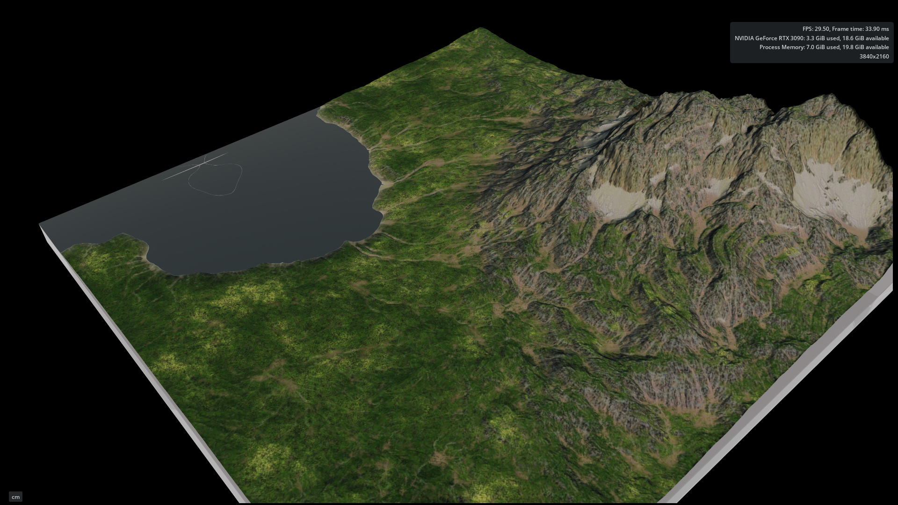
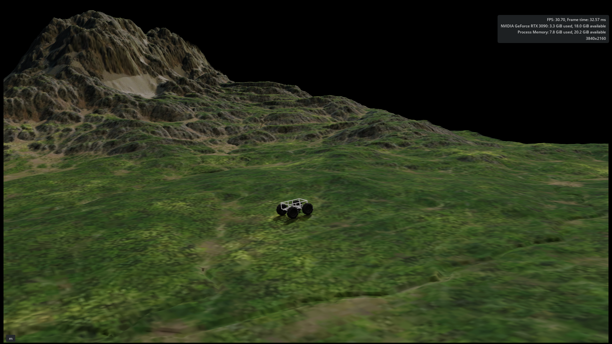

# Off-Road Mobile Robot Simulation and ROS 2 Control

This repository contains simulation assets and ROS 2 components for a skid-steer off-road mobile robot. It includes robot description and geometry files, simulation-related assets for MuJoCo and NVIDIA Isaac Sim, velocity command processing, kinematic wheel control, and odometry utilities.

## Project Overview

The project combines robot modeling and simulation assets with ROS 2 components for controlling the robot and estimating its motion.

### Main Components

- **Robot Modeling and Simulation:** Robot descriptions and geometry assets in Xacro/URDF, XML, USD/USDA, STL, OBJ, and MTL formats.
- **Velocity Command Filtering:** A configurable ROS 2 node that limits linear and angular acceleration and deceleration and handles command timeouts.
- **Kinematic Wheel Control:** A ROS 2 controller that converts linear and angular velocity commands into wheel-joint trajectory commands using the robot's wheel radius and wheelbase.
- **Encoder-Based Odometry:** A ROS 2 node that estimates planar robot motion from wheel joint states and publishes odometry and, optionally, TF transforms.
- **Odometry Frame Conversion:** A component for converting LiDAR-based odometry into the configured robot reference frame using TF transformations.

## ROS 2 Packages

### 1. `outdoor_description`

Contains robot description files, mechanical geometry assets, launch files, and RViz configurations.

The package includes:

- Robot descriptions in Xacro/URDF and other exported formats.
- STL and OBJ/MTL mesh assets.
- Robot state publishing and visualization configurations.
- Static TF definitions for simulated sensors, including LiDAR, IMU, and cameras.

### 2. `outdoor_controller`

Contains ROS 2 nodes for velocity command processing and kinematic wheel control.

- `cmd_vel_filter_node`: Applies configurable acceleration and deceleration limits to linear and angular velocity commands and handles command timeouts.
- `kinematic_controller_node`: Converts filtered velocity commands into wheel-joint trajectory commands based on the robot's wheel radius and wheelbase.

The package also includes launch files and YAML configuration parameters.

### 3. `outdoor_odometry`

Contains ROS 2 nodes for odometry estimation and reference-frame conversion.

- `encoder_odometry_node`: Estimates planar position and orientation from wheel joint velocities and can publish the `odom` to `base_link` transform.
- `frame_converter_node`: Converts incoming odometry data between configured reference frames using TF transformations.
- `odometry_state_machine_node`: Provides an additional state-machine-based odometry component.

## Simulation Environments

The repository includes USD environment assets, including `mountain.usd` and `mountain_fixed.usd`, alongside environment images.

### Mountain Lake





## Build the ROS 2 Workspace

Use a compatible ROS 2 installation with the dependencies required by the packages in this repository.

```bash
source /opt/ros/<ros_distro>/setup.bash

cd outdoor_ws

rosdep install --from-paths src --ignore-src -r -y

colcon build --symlink-install

source install/setup.bash
```

Replace `<ros_distro>` with the ROS 2 distribution installed on your system.

## Available Launch Files

After building the workspace and sourcing the environment, the repository provides the following launch files:

- **Robot visualization:** `outdoor_description/launch/display.launch.py`
- **Velocity filtering and kinematic control:** `outdoor_controller/launch/kinematic_controller.launch.py`
- **Odometry components:** `outdoor_odometry/launch/outdoor_odometry.launch.py`

The appropriate simulator, sensor inputs, and ROS 2 topic configuration may be required depending on the component being launched.

## Technologies

- ROS 2
- C++
- MuJoCo
- NVIDIA Isaac Sim
- URDF/Xacro and XML
- USD/USDA
- RViz2
- TF2
- Colcon and CMake
